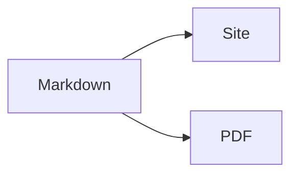

# grimoire-mermaid

A [Grimoire](https://github.com/jennifer-language/grimoire) preprocessor that
draws a book's `mermaid` fences as pictures while the book is built. Every
edition shows the diagram: the site and the EPUB get an SVG, the printable book
a PNG, and no reader's browser has to run JavaScript.

A user plugin by mplx, not maintained by the Grimoire project, and not in
Grimoire's container image.

## What it needs

- **Grimoire 0.5.0 or later.** The plugin uses the `files` feature of the
  plugin contract (api 1) and refuses an older Grimoire, saying so.
- **A renderer**, installed by you:
  - [`merman-cli`](https://github.com/Latias94/merman) (default), checked with
    0.10.0; it needs a font file, see `font` below;
  - or [`mmdr`](https://github.com/1jehuang/mermaid-rs-renderer), checked with
    0.3.1, with `renderer = "mmdr"`.
- `fc-match` (fontconfig), for merman's default font, unless `font` is set.

A build runs nothing else and fetches nothing. A book with no `mermaid` fence
runs no renderer at all.

## Install

```sh
jvc app install https://github.com/mplx/grimoire-mermaid                   # onto PATH
jvc app install https://github.com/mplx/grimoire-mermaid --scope project   # beside one book
```

The command is `grimoire-mermaid`, which is what Grimoire runs for a
`[preprocessor.mermaid]` table. With `--scope project`, or a plain checkout,
point `command` at the launcher:

```toml
[preprocessor.mermaid]
command = "bin/grimoire-mermaid"
```

## Use

```toml
[preprocessor.mermaid]
```

is enough. Then, in a chapter:

````markdown

````

becomes a paragraph holding only the picture:

```markdown

```

- **Fences** follow CommonMark: three or more backticks or tildes, up to three
  spaces of indentation, an info string whose first word is `mermaid`. A fence
  inside a longer fence, and indented code, are left as code, so a page can
  still show the syntax. A fence in a list item keeps its indentation, and the
  picture stays in the item.
- **Not in block quotes:** a `mermaid` fence inside a block quote (`> `) is
  not recognised and stays code. Put the diagram outside the quote.
- **The alt text** is the diagram's `accTitle:`, or "Diagram". It is also what
  the printable book prints for a picture it cannot draw, and the caption a
  later `grimoire-figure` writes.
- **Files** are named after a hash of the diagram, the renderer and its version,
  and the settings that change the picture. The same diagram twice is drawn
  once, and a rebuild writes the same names. They are written to the directory
  Grimoire hands the plugin and appear in the site under
  `_generated/<table name>/`; a chapter links to them relative to itself.
- **The printable book** draws `<hash>.png`, which Grimoire finds beside the
  SVG the chapter links. At `scale = 2` the PNG has twice the diagram's pixels,
  so `[pdf] imageDpi = 192` prints it at its own size.
- **Distinct diagrams render concurrently**, up to `jobs` at a time. The reply
  and the files do not depend on which finishes first, so the book is the same
  at any `--jobs`.

## Settings

```toml
[preprocessor.mermaid]
renderer = "merman"   # or "mmdr"
program = ""          # the renderer's path, when it is not on PATH
theme = "neutral"     # handed to the renderer: neutral, default, dark, forest, ...
font = ""             # merman only: a font file; default the file fc-match names for DejaVu Sans
png = true            # false: SVG only, for a book without a PDF
scale = 2             # the PNG's size against the diagram's own, above 0 and at most 8
jobs = 0              # renders at a time; 0 is one per CPU
```

Any other key is an error, apart from Grimoire's own `command` and `args`. The
renderer's path is `program` rather than `command`, because Grimoire reads
`command` as the plugin's own path.

What the plugin runs:

| | SVG | PNG |
| - | - | - |
| merman | `merman-cli render - -f svg --svg-pipeline resvg-safe -t THEME --font-file FONT` | `merman-cli render - -f png -s SCALE -t THEME --font-file FONT` |
| mmdr | `mmdr -i - -e svg -t THEME` | `mmdr -i - --size`, then `mmdr -i - -e png -t THEME -w W -H H` at the diagram's size times `scale` |

`--svg-pipeline resvg-safe` turns merman's HTML labels into SVG text, which EPUB
readers draw. The font goes to the SVG too, so its layout matches the PNG's;
without one, merman's PNG export scans every system font and can fail on a
machine with many. mmdr has no font setting and no scale of its own.

## Errors

The plugin is strict: a problem stops the build rather than leaving a hole in
it. Grimoire reports the plugin's message, for example:

```
grimoire: preprocessor mermaid: exited 1: grimoire-mermaid: guide/build.md:12: merman-cli: Diagram parse error (flowchart-v2): unexpected end of input
```

- a diagram the renderer refuses names the chapter, the fence's line and the
  renderer's first line;
- an unclosed `mermaid` fence, an unknown setting and a value of the wrong kind
  are refused;
- a missing renderer or font says what to install or which setting to change;
- a diagram over 256 KiB, or a rendered file over 16 MiB, throws `"limit"`.

## Development

```
bin/grimoire-mermaid     the launcher: read stdin, run the module, exit its status
src/mermaid.j            the module: settings, alt text, the renderers' command lines
src/mermaid_test.j       its tests
tests/fake-renderer      a stand-in renderer the tests drive through `program`
examples/book/           a book with three diagrams and every edition enabled
```

The plugin is built on Grimoire's plugin kit. `src/pluginkit.j` is a copy of
Grimoire's `src/pluginkit.j` (Grimoire 0.5.0 or later), imported as
`./pluginkit.j`; it is not edited here. The kit gives the request and reply
handling, the CommonMark fence scanner, settings, content-hash names and the
concurrent drawing; `src/mermaid.j` holds only what is Mermaid's.
`scripts/sync-kit.sh` refreshes the copy from a Grimoire checkout beside this
one (or `$GRIMOIRE_SRC`), and `scripts/test.sh` warns when the two differ.

```sh
scripts/sync-kit.sh                                              # refresh the kit copy
scripts/test.sh                                                  # fmt, lint, tests
GRIMOIRE="$PWD/../grimoire/bin/grimoire" scripts/check-example.sh  # the example, end to end
```

The tests run against the fake renderer, and against `merman-cli` and `mmdr`
when they are installed: two builds have to give the same bytes.
`scripts/check-example.sh` builds the example book with a Grimoire checkout and
checks the site, the EPUB and the PDF; `RENDERER=mmdr` checks the other
renderer.

`NEEDS` names `merman-cli`, for an image that would carry the plugin.

## Licence

LGPL-3.0-only, see [LICENSE](LICENSE).
