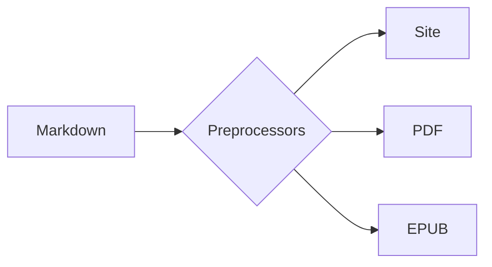
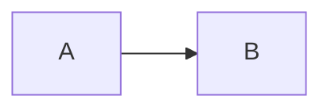

# Diagrams

Each fence below is drawn while the book is built. The site and the EPUB show
the SVG, the printable book the PNG beside it.



A fence shown as an example stays code:

````markdown

````
